  

# Hi, I'm Parneet! 👋

I'm a computer science student looking for a co-op. I like building things I can test, break and learn from, and lately I've been most interested in how AI systems behave: what they leak, what they get wrong, and who they treat differently.

  

<h3 align="center">I build and break AI systems to learn how they fail.</h3>

  

## Projects

<table align="center">
  <tr>
    <td valign="top" width="50%">
      
    </td>
    <td valign="top" width="50%">
      
    </td>
  </tr>
  <tr>
    <td valign="top" width="50%">
      
    </td>
    <td valign="top" width="50%">
      
    </td>
  </tr>
</table>

## Tools I use

Python · JavaScript · Typescript · HTML/CSS · Flask · Pandas · scikit-learn · Three.js · Git and GitHub · VS Code · C++ · Java · Feature Encoding · Model evaluation · Data Cleaning · NumPy · XGBoost

  

