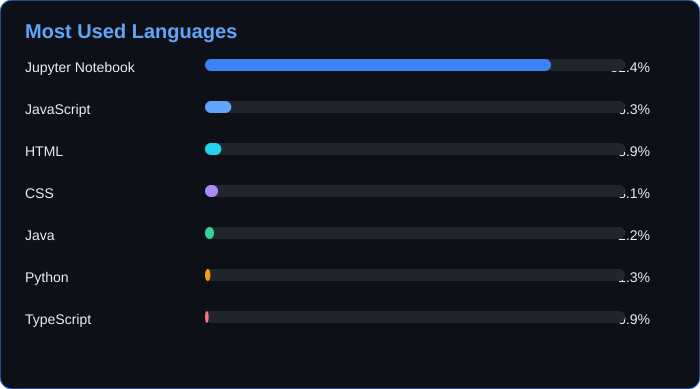

<!-- HEADER -->

  

<h1 align="center">Hi, I'm Parneet! 👋</h1>

  <b>Computer Science Student @ York University</b>
   
  Software Development · Artificial Intelligence · Machine Learning

  
  

---

## About Me

I'm a computer science student looking for a co-op. I like building things I can test, break and learn from, and lately I've been most interested in how AI systems behave: what they leak, what they get wrong, and who they treat differently.

<h3 align="center">
  I build and break AI systems to learn how they fail.
</h3>

  

---

## Featured Projects

<table>
<tr>
<td width="50%" valign="top">

### 🔍 [LLM Audit](https://github.com/PXRI-hub/llm-audit)

Exploring AI system behaviour, information leakage, and model reliability.

**Focus:** AI Evaluation · Security · Testing

</td>
<td width="50%" valign="top">

### 🤖 [Break the Bot](https://github.com/PXRI-hub/Break-the-Bot)

Testing AI limitations, unexpected responses, and model behaviour.

**Focus:** AI Testing · Model Evaluation

</td>
</tr>

<tr>
<td width="50%" valign="top">

### 📊 [Adult Income Prediction](https://github.com/PXRI-hub/adult-income-prediction)

Machine learning classification using real-world census data and multiple predictive models.

**Stack:** Python · Pandas · scikit-learn · XGBoost

</td>
<td width="50%" valign="top">

### 🧩 [3D Rubik's Cube](https://github.com/PXRI-hub/3D-Rubics-Cube)

An interactive 3D Rubik's Cube built using web technologies.

**Stack:** JavaScript · Three.js

</td>
</tr>
</table>

---

## Technologies & Tools

**Programming Languages**

**AI, Machine Learning & Data**

**Development Tools & Frameworks**

---

## Programming Language Breakdown

<!--
The chart below is generated by the GitHub Actions
workflow at .github/workflows/languages.yml.

It will appear once the workflow has successfully run.
-->

<b>View language usage statistics</b>

 

  

  Calculated from public repository code size, not skill proficiency.

---

  <b>Currently seeking Software Development Co-op opportunities for May 2027.</b>

  

